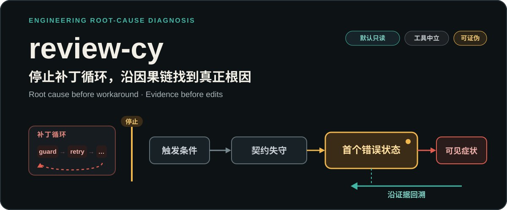
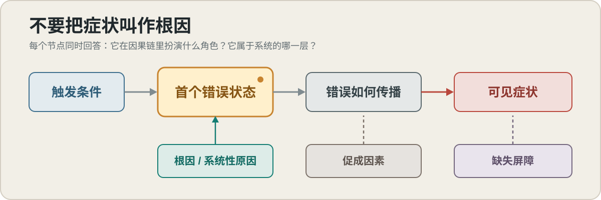

<p align="center">
  
</p>

<p align="center">
  <strong>当 AI 越修越乱，先停止改代码，再证明问题从哪里开始。</strong>
</p>

<p align="center">
  面向 Vibe coding / AI 编码过程的工程根因诊断 Skill。
</p>

<p align="center">
  <code>默认只读</code> · <code>工具中立</code> · <code>证据驱动</code> · <code>根因优先</code>
</p>

`review-cy` 不再做一遍普通 code review，也不会在报错处继续堆 `guard`、`retry` 或 `fallback`。它会先冻结补丁循环，建立失败契约和最小系统模型，再沿数据、控制与状态边界回溯到**首个错误状态**，用可证伪假设判断问题真正位于实现、契约、框架集成、组件设计、系统架构还是运行环境。

## 30 秒开始

**1. 安装**

```bash
# Codex
git clone https://github.com/CY-CHENYUE/review-cy.git ~/.codex/skills/review-cy

# Claude Code
git clone https://github.com/CY-CHENYUE/review-cy.git ~/.claude/skills/review-cy
```

**2. 直接说**

```text
这个 bug AI 已经修了三轮，还是没解决。
先别改代码，用 review-cy 找真正根因。
```

**3. 看成功信号**

- 报告明确标记 `CONFIRMED`、`PROVISIONAL` 或 `INCONCLUSIVE`。
- 区分症状、触发条件、首个错误状态、传播机制和根因层级。
- 将 `CONTAINMENT`、`ROOT_CORRECTION` 与 `PREVENTION` 分开。
- 默认不修改源码；证据不足时给出下一项最有区分力的实验。

## 它和继续打补丁有什么不同

| 常见修法 | `review-cy` 的做法 |
|---|---|
| 在最后报错处加保护 | 回溯正确状态第一次变坏的位置 |
| 用最近改动或相似故障猜原因 | 为竞争假设写预测并主动寻找反证 |
| 测试变绿就宣布修复完成 | 证明哪条契约或不变量已经恢复 |
| 把复杂问题直接叫作架构问题 | 用跨边界证据和质量属性场景判定层级 |
| 回滚、重试、扩容后结束 | 把临时止血、根因纠正和防复发动作分开 |

### 一个典型的诊断转向

> 登录 bug 已经修了四次：刷新 token、清缓存、扩大超时、吞掉 401。现在错误从登录页移到了后台同步任务。

`review-cy` 不会给出第五个猜测性修改。它会先把四次尝试整理为“假设 → 预测 → 实际结果 → 残余证据”，再贯穿前台与后台检查 token 生命周期、状态所有权、消费者契约和缓存边界。症状迁移只说明补丁碰到了传播链；在区分实验闭环前，结论仍会保持 `PROVISIONAL` 或 `INCONCLUSIVE`。

## 从症状回到首个错误状态

<p align="center">
  
</p>

`review-cy` 不把“最后哪里报错”当成“问题从哪里产生”。它会：

1. **冻结补丁循环**：记录每次修改的假设、预测和实际结果。
2. **建立失败契约**：明确 Expected、Actual、Trigger、Scope、Timeline 和 Oracle。
3. **定位首个错误状态**：从可见症状反向追踪，同时沿正常路径正向核对。
4. **区分竞争假设**：优先执行信息增益高、风险低的只读检查或单变量实验。
5. **判定责任层级**：找到最早拥有相关不变量、能关闭整类故障路径的位置。

## 你会得到什么

```text
Status: CONFIRMED | PROVISIONAL | INCONCLUSIVE

One-line diagnosis
Problem contract
Causal map
Layer assessment
Evidence and hypothesis ledger
Patch test

CONTAINMENT
ROOT_CORRECTION
PREVENTION

Verification
Unknowns and next discriminating experiment
```

证据不足时不会强行编出一个根因：报告会明确未知项、仍成立的竞争假设，以及哪项新证据会改变当前判断。

## 适合与不适合

| 适合使用 | 不适合使用 |
|---|---|
| AI 已经修了多轮，原问题仍在或症状不断迁移 | 普通 PR / diff review 或 merge 门控 |
| 测试通过但生产、CI 或真实环境仍失败 | 代码风格、命名和格式检查 |
| 并发、缓存、生命周期、状态所有权问题 | 没有具体故障场景的泛泛架构讨论 |
| 构建、依赖、框架集成或性能退化 | 纯功能实现 |
| 怀疑问题跨越组件、契约或故障边界 | 根因已经确认后的机械修复 |

线上事故可以先回滚、隔离、限流或关闭功能，但这些动作只会标为 `CONTAINMENT`。保存关键证据后，诊断仍会继续。

## 根因可能在哪一层

- `IMPLEMENTATION`：局部实现违反了已经明确且合理的契约。
- `CONTRACT`：生产者、消费者或状态转换对不变量的理解不一致。
- `FRAMEWORK_INTEGRATION`：应用误解了框架生命周期、调度、资源或配置语义。
- `COMPONENT_DESIGN`：组件内部缺少稳定的状态所有者、抽象或约束位置。
- `SYSTEM_ARCHITECTURE`：问题来自跨组件拓扑、共享状态、耦合、一致性或故障边界。
- `RUNTIME_ENVIRONMENT`：配置、权限、资源、版本、工具链或外部系统差异是必要条件。

层级不是严重度排名。小改动也可以是根因纠正，大重构也可能只是掩盖症状。

## 深入使用

- [SKILL.md](SKILL.md)：完整触发条件、授权边界和诊断协议。
- [系统化排查](references/investigation-workflow.md)：复现、成功对照、边界取证和区分实验。
- [因果模型](references/causal-model.md)：区分 symptom、trigger、mechanism、root cause 与 missing barrier。
- [根因层级](references/diagnosis-layers.md)：实现、契约、框架、设计、架构和环境的证据门槛。
- [反补丁审判](references/anti-patch.md)：判断候选方案是止血、根因纠正还是症状补丁。
- [诊断报告](references/evidence-and-report.md)：证据强度、结论状态和完整输出模板。

## 验证

仓库包含 14 个行为评测场景和一组静态契约测试，用于约束 Skill 的触发、只读边界、因果分层与输出状态：

```bash
bash tests/test-skill-contract.sh
```

这些检查证明诊断协议的结构与关键约束完整，不代表对真实项目的根因命中率承诺。

## 交流

<div align="center">
  <p>扫码关注公众号，获取更新与交流反馈</p>
  
</div>
